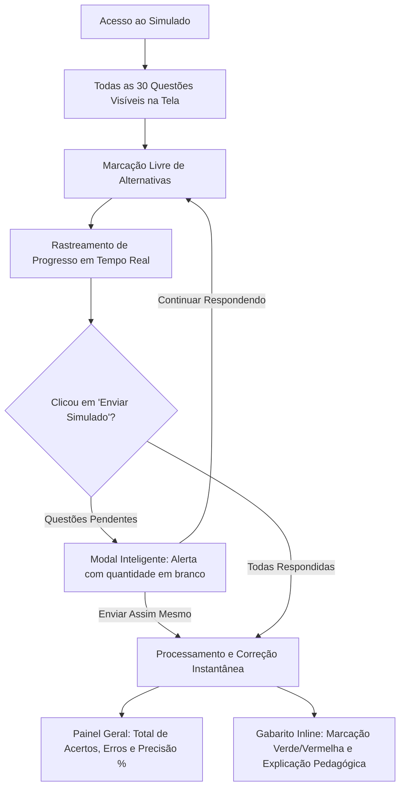

<div align="center">

# 🗄️ Mestre do Banco de Dados Avançado
### *Plataforma Interativa de Estudos, Resumos Teóricos e Simulado Oficial Oracle PL/SQL*

[](https://wallace-2105.github.io/Banco-de-Dados-Avancado/)
[](https://www.oracle.com/database/)
[](https://developer.mozilla.org/pt-BR/docs/Web/JavaScript)
[](https://developer.mozilla.org/pt-BR/docs/Web/CSS)
[](https://developer.mozilla.org/pt-BR/docs/Web/HTML)
[](LICENSE)

<br />

🚀 **[Acessar a Aplicação Online no GitHub Pages](https://wallace-2105.github.io/Banco-de-Dados-Avancado/)** 🚀

<br />

> *"Este projeto foi concebido como material de apoio didático e simulador interativo de provas acadêmicas na área de Banco de Dados Avançado e Engenharia de Software, servindo como guia de estudos permanente para estudantes universitários e aspirantes a DBAs."*

</div>

---

## 📌 Sumário
- [🎯 Visão Geral e Propósito](#-visão-geral-e-propósito)
- [🌐 Demonstração Online](#-demonstração-online)
- [📚 Ementa e Módulos Teóricos](#-ementa-e-módulos-teóricos)
- [🧩 Simulado Interativo com 30 Questões](#-simulado-interativo-com-30-questões)
- [🛠️ Tecnologias e Arquitetura](#️-tecnologias-e-arquitetura)
- [📁 Estrutura do Repositório](#-estrutura-do-repositório)
- [💻 Como Executar Localmente](#-como-executar-localmente)
- [🤝 Contribuições Acadêmicas](#-contribuições-acadêmicas)
- [👨‍💻 Autor e Licença](#-autor-e-licença)

---

## 🎯 Visão Geral e Propósito

Nas disciplinas de **Banco de Dados Avançado** de cursos de Tecnologia da Informação (Ciência da Computação, Engenharia de Software, Sistemas de Informação e Análise e Desenvolvimento de Sistemas), o ecossistema **Oracle Database** e a linguagem procedural **PL/SQL** representam um dos pilares mais cobrados em avaliações universitárias, certificações industriais (Oracle Certified Associate) e provas técnicas de contratação.

O **Mestre do Banco de Dados Avançado** nasceu da necessidade real de consolidar esse conteúdo de forma prática, moderna e acessível:
- **Centralizar a teoria essencial:** Sem enrolação, focando exatamente nos comandos, operadores, sintaxes e comportamentos que costumam cair em provas.
- **Ambiente de Simulado Real:** Todas as questões são dispostas simultaneamente, permitindo que o aluno simule a experiência de um exame presencial universitário.
- **Gabarito com Explicações Pedagógicas:** Ao enviar o teste, cada questão revela imediatamente a justificativa técnica detalhada do porquê cada alternativa está correta ou incorreta.

---

## 🌐 Demonstração Online

A aplicação está hospedada e disponível publicamente através do GitHub Pages:

🔗 **Link de Acesso:** [https://wallace-2105.github.io/Banco-de-Dados-Avancado/](https://wallace-2105.github.io/Banco-de-Dados-Avancado/)

> [!TIP]
> A aplicação é **100% responsiva** e funciona com fluidez em computadores, tablets e smartphones, permitindo estudar tanto no computador do laboratório quanto no celular durante deslocamentos.

---

## 📚 Ementa e Módulos Teóricos

A seção de **Resumos Teóricos** está estruturada em *accordion* (seções sanfonadas) pesquisável e com realce de sintaxe:

| Módulo | Conteúdo Abordado | Conceitos Críticos |
| :--- | :--- | :--- |
| **Módulo 01: Fundamentos de PL/SQL e Selects** | Extensão procedural da Oracle, operadores de seleção e ordenação de conjuntos. | `DISTINCT`, `LIKE '%..%'`, `IN`, `BETWEEN`, `IS NULL`, `ORDER BY ASC / DESC`. |
| **Módulo 02: Procedures vs Functions** | Diferenciação prática entre blocos nomeados de execução de tarefas e de cálculo/retorno. | `CREATE OR REPLACE`, obrigatoriedade do `RETURN` em Functions, parâmetros `IN`/`OUT`. |
| **Módulo 03: Controle de Fluxo e Loops** | Estruturas condicionais, laços de iteração e tratamento robusto de erros em tempo de execução. | `IF ... ELSIF ... ELSE`, `FOR i IN 1..5 LOOP`, exceções `ZERO_DIVIDE`, `TOO_MANY_ROWS`, `NO_DATA_FOUND` e `WHEN OTHERS`. |
| **Módulo 04: Triggers (Gatilhos de Banco)** | Procedimentos acionados automaticamente por eventos DML/DDL ou eventos de sistema. | Momentos `BEFORE` e `AFTER`, cláusula `FOR EACH ROW`, pseudo-registros `:NEW` e `:OLD`. |
| **Módulo 05: Sequences e Tipos de Joins** | Geradores de chaves numéricas e álgebra relacional de junções entre tabelas. | `NEXTVAL` e `CURRVAL`, comparações completas entre `INNER`, `LEFT`, `RIGHT`, `FULL`, `CROSS` e `NATURAL JOIN` (e seus riscos de tipos incompatíveis). |

### Recursos da Área Teórica:
- 🔍 **Barra de Busca Instantânea:** Digite termos como `"trigger"`, `"exception"` ou `"join"` para filtrar resumos em tempo real.
- 📋 **Botão Copiar Código:** Copie snippets prontos de SQL e PL/SQL diretamente para a área de transferência.
- ⚡ **Expansão Rápida:** Botões para expandir ou recolher todos os tópicos de uma vez.

---

## 🧩 Simulado Interativo com 30 Questões

Diferente de quizzes simplistas de uma pergunta por tela, o sistema foi desenhado no formato de **avaliação universitária real**:



### Características do Simulado:
1. **Todas as 30 Perguntas na Mesma Página:** Liberdade para ler, comparar e escolher a ordem de resposta.
2. **Distribuição Equilibrada por Dificuldade:**
   - 🟢 **Fácil (Questões 1 a 10):** Definições e fundamentos teóricos do Oracle.
   - 🟡 **Médio (Questões 11 a 20):** Lógica relacional, exceções escalares e pseudo-registros.
   - 🟣 **Difícil / Prático (Questões 21 a 30):** Desafios de código e consultas SQL formatados com blocos de sintaxe monoespaçada (`pre`/`code`).
3. **Filtro de Dificuldade:** Opção de realizar o simulado completo (30 questões) ou focar em uma dificuldade específica (10 questões).
4. **Modal Inteligente de Confirmação:** Caso você clique em enviar com questões em branco, o sistema avisa a quantidade pendente e pede confirmação sem pop-ups intrusivos.
5. **Gabarito e Correção Pedagógica:**
   - Destaca em verde o que você acertou.
   - Destaca em vermelho onde você errou e sinaliza a alternativa certa.
   - Apresenta uma justificativa técnica logo abaixo de cada alternativa para garantir o aprendizado.
6. **Efeitos Sonoros com Web Audio API:** Síntese de áudio nativa do navegador (sem arquivos pesados externos) com opção de silenciar a qualquer momento.

---

## 🛠️ Tecnologias e Arquitetura

O projeto foi construído seguindo o padrão de **Engenharia Web Vanilla**, sem dependências pesadas de frameworks, garantindo performance extrema, carregamento instantâneo e facilidade de manutenção:

- **HTML5 Semântico:** Estruturação em `<header>`, `<main>`, `<section>`, `<article>` e `<nav>` com boas práticas de acessibilidade (ARIA).
- **CSS3 Moderno:**
  - *Design System* proprietário com paleta inspirada no ecossistema tecnológico da Oracle (*Tech Blue & Deep Slate*).
  - Uso extensivo de variáveis CSS (`:root`), Flexbox, CSS Grid e animações suaves (`cubic-bezier`).
  - Efeitos de profundidade e *glassmorphism* com `backdrop-filter`.
- **JavaScript Moderno (ES6+):**
  - Manipulação modular de estado (`appState`).
  - Geração dinâmica de elementos DOM sem recarregamento de página (*Single Page Experience*).
  - Efeitos de áudio sintetizados diretamente via **Web Audio API** (`AudioContext`, `OscillatorNode`, `GainNode`).
  - Zero dependências externas (sem jQuery, Bootstrap ou bibliotecas de terceiros).

---

## 📁 Estrutura do Repositório

```text
Banco-de-Dados-Avancado/
├── 📄 index.html       # Estrutura semântica completa (resumos, simulador e modais)
├── 🎨 style.css        # Folha de estilos, tokens de design e responsividade
├── ⚡ script.js        # Banco de 30 questões, controle de áudio e lógica de avaliação
└── 📘 README.md        # Documentação técnica e guia do estudante
```

---

## 💻 Como Executar Localmente

Como a aplicação é puramente estática, você pode executá-la em qualquer máquina sem precisar instalar gerenciadores de pacotes ou servidores complexos:

### Método 1: Abertura Direta
1. Clone o repositório:
   ```bash
   git clone https://github.com/wallace-2105/Banco-de-Dados-Avancado.git
   ```
2. Abra a pasta do projeto e dê um duplo clique no arquivo [`index.html`](file:///c:/banco%20de%20dados%20avan%C3%A7ado/Banco-de-Dados-Avancado/index.html).

### Método 2: Servidor Local de Desenvolvimento (Opcional)
Se preferir utilizar um servidor de desenvolvimento:

```bash
# Com Node.js / npx:
npx serve .

# Ou com Python:
python -m http.server 8000
```
Acesse no navegador: `http://localhost:8000`

---

## 🤝 Contribuições Acadêmicas

Este repositório é de código aberto e visa ajudar a comunidade acadêmica! Se você é estudante, professor ou profissional e deseja contribuir:

1. Faça um **Fork** deste repositório.
2. Crie uma branch para sua melhoria:
   ```bash
   git checkout -b feature/nova-questao-ou-modulo
   ```
3. Adicione novas questões ao banco de dados no [`script.js`](file:///c:/banco%20de%20dados%20avan%C3%A7ado/Banco-de-Dados-Avancado/script.js) ou enriqueça os resumos no [`index.html`](file:///c:/banco%20de%20dados%20avan%C3%A7ado/Banco-de-Dados-Avancado/index.html).
4. Faça o commit das suas alterações:
   ```bash
   git commit -m "feat: adicionar nova questao sobre Triggers com cursor"
   ```
5. Envie para o GitHub:
   ```bash
   git push origin feature/nova-questao-ou-modulo
   ```
6. Abra um **Pull Request**.

---

## 👨‍💻 Autor e Licença

Desenvolvido por **[Wallace](https://github.com/wallace-2105)** como projeto de apoio acadêmico para estudantes de Engenharia de Software e Banco de Dados.

Distribuído sob a licença **MIT**. Veja o arquivo `LICENSE` para mais detalhes.

<div align="center">
  <sub>Feito com dedicação para fortalecer os estudos em Banco de Dados Avançado. Se este projeto te ajudou, deixe uma ⭐ no repositório!</sub>
</div>